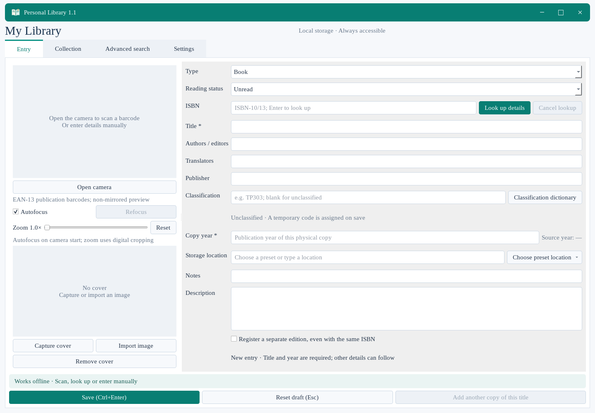
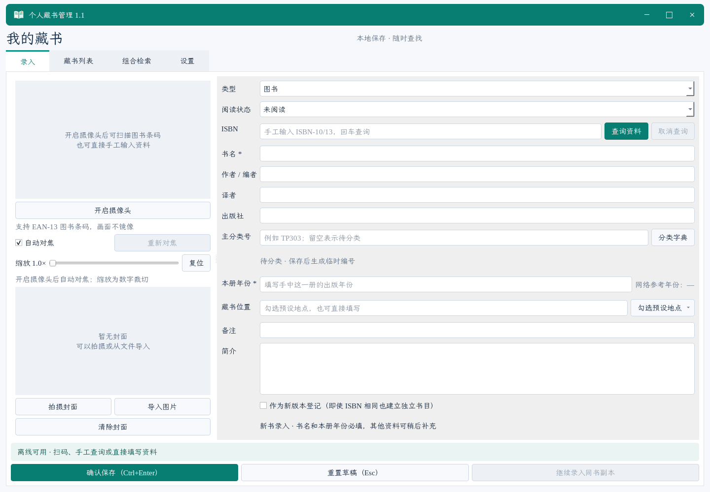

  

<h1 align="center">Personal library with camera 个人藏书管理 · 摄像头封面采集</h1>

<strong>A place for every book. Your reading at a glance. 让每本书有处可寻，让阅读状态一目了然。</strong>

  Windows 10 / 11 · x64 · v1.1 
  <a href="https://github.com/hwt95/Personal-library-with-camera/releases/tag/v1.1"><strong>Download / 下载</strong></a> ·
  <a href="#english">English</a> · <a href="#简体中文">简体中文</a> ·
  <a href="LICENSE">PolyForm Noncommercial 1.0.0</a>

<table>
<thead><tr><th width="50%">English</th><th width="50%">简体中文</th></tr></thead>
<tbody>
<tr>
<td valign="top">
<h3>What you can do</h3>

<strong>Catalogue books and magazines.</strong> Scan ISBN or ISSN barcodes, add covers, and record magazine years and issues.

<strong>Find the copy you own.</strong> Keep shelf locations, reading status and copy notes together; search across your collection.

<strong>Keep your library close.</strong> Save records and covers in one local database, make backups, and export lists to CSV.

</td>
<td valign="top">
<h3>主要功能</h3>

<strong>图书、杂志一起收。</strong> 扫描 ISBN 或 ISSN 条码，拍摄封面，记录杂志年度和期数。

<strong>找到手里的那一本。</strong> 存放位置、阅读状态和每册备注放在一起，随时组合检索。

<strong>书库放在自己身边。</strong> 书目与封面保存在一个本地数据库中，支持完整备份和 CSV 导出。

</td>
</tr>
<tr>
<td valign="top">
<h3>What makes it different</h3>

<strong>One camera, a continuous workflow.</strong> After a scan, the camera stays ready for the cover photo.

<strong>Automatic framing, with room for your eye.</strong> Local models find the corners and orientation. A magnifier and keyboard controls help with the finishing touches.

<strong>Made for real shelves.</strong> Class-based call numbers, separate copies, six interface languages, and a portable folder you can take with you.

</td>
<td valign="top">
<h3>创新点与贴心设计</h3>

<strong>一扫一拍，顺手录完。</strong> 扫码后摄像头继续工作，直接接上封面拍摄。

<strong>自动找边，细节由你掌握。</strong> 本地模型识别四角和朝向，配合顶点放大镜与键盘微调，把封面裁得更合心意。

<strong>围着真实书架来设计。</strong> 分类内编号、独立副本、六种界面语言，装在一个可以随身带走的便携文件夹里。

</td>
</tr>
</tbody>
</table>

## English

A book on the shelf, a magazine beside the sofa, a second copy tucked away in the study: small collections have a way of spreading out. Personal library with camera gives them a home you can search. Point the camera at a barcode, take a cover photo, and choose where that copy belongs. You can also type everything in, so older books without a barcode are welcome too.

### Start with a clear desk

The English entry screen below is empty: no book records, cover images or personal details have been added.

### From a barcode to your bookshelf

Book lookups use Open Library and, when you provide a key, Google Books. The Simplified Chinese interface also offers the National Library of China source. Choose the details you need and fill in anything missing. Each copy has its own year, location, notes and reading status, while copies of the same title share their book details and cover.

Magazines have their own entry layout with a year and issue number. You can mark a book or magazine as unread, in progress or finished, then use those choices to find your next read.

### A cover that looks like your book

Use the live camera or an existing photo. The application finds the cover edges, straightens the perspective and suggests an upright orientation, all on your computer. Drag a corner, open the magnified editor or rotate the image when it needs a small adjustment. Your cover photos stay on your device.

### Keep it in a place you choose

Your catalogue, copies and saved covers live in a SQLite file that you choose. The application offers full backups and CSV exports, and the portable package includes its runtime, fonts and local models. The interface is available in English, Simplified Chinese, French, Spanish, Russian and Arabic.

1. Download **PersonalLibrary-v1.1-Windows-x64.zip** from [Releases](https://github.com/hwt95/Personal-library-with-camera/releases/tag/v1.1).
2. Extract the whole folder and open **PersonalLibrary.exe**. Keep the `_internal` folder beside it.
3. Create a library or open your existing one. Choose a folder you can write to and back up easily.

Moving from 1.0? Version 1.1 makes a backup before upgrading an older database and keeps a record of the old and new call numbers. Keep that backup if you may return to the older application.

### Licence and credits

The original application is available under the unmodified [PolyForm Noncommercial 1.0.0](LICENSE), including its listed institutional uses. Commercial use outside the permitted purposes needs [separate written permission](COMMERCIAL_LICENSING.md). This is a source-available licence, not an OSI-approved open-source licence. Please retain the author and source notices in [NOTICE](NOTICE).

Third-party software, fonts, models and data keep their own terms. See [licence scope](LICENSING.md), [data sources](DATA_SOURCES.md), and [corresponding third-party source downloads](docs/SOURCE_DOWNLOADS.md). Those source downloads are for people who want to study or change the libraries; they are not needed to run the application.

[What's new in 1.1](CHANGELOG.md) · [Build from source](docs/BUILD.md) · [Report an issue](https://github.com/hwt95/Personal-library-with-camera/issues)

## 简体中文

书架上一本，沙发边一本，书房里还放着同一本书的另一个版本。藏书渐渐多起来，记住它们放在哪里，也成了一件小事。这个软件想帮你把这件小事做好：对着条码扫一扫，给封面拍张照，再记下它属于哪个书架。没有条码的旧书，也可以从手工填写开始。

### 从一张干净的录入页开始

下面是中文空白首屏，没有录入书目、封面或个人信息。

### 从扫到一本书，到找到那一本书

简体中文界面提供国家图书馆、Open Library 和可选的 Google Books 书目查询。资料找到了，就挑选需要的内容；缺少的字段，可以自己补上。同一本书的不同副本共享书目与封面，每一册又有自己的年份、位置、备注和阅读状态。

杂志有单独的录入方式，可以记录年度和期数。给图书或杂志标上“未阅读”“阅读中”或“已阅读”，下次想找一本书接着读，就更容易了。分类内递增的馆藏编号和副本后缀，也能让书架上的次序更清楚。

### 给封面留一个舒服的样子

可以实时拍摄，也可以导入已有照片。本地模型帮你找四角、裁正透视、调整朝向；遇到反光或边缘不清楚的封面，再拖动顶点，用放大镜和方向键慢慢修整。你拍下的照片始终在本机处理。

### 把书库放在自己选的地方

书目、实体副本和封面保存在你选择的 SQLite 文件里，随时可以完整备份或导出 CSV。便携包带齐运行库、字体和模型，解压就能用。界面支持简体中文、英语、法语、西班牙语、俄语和阿拉伯语，可在设置中切换。

1. 在 [Releases](https://github.com/hwt95/Personal-library-with-camera/releases/tag/v1.1) 下载 **PersonalLibrary-v1.1-Windows-x64.zip**。
2. 完整解压后打开 **PersonalLibrary.exe**，保留旁边的 `_internal` 文件夹。
3. 新建书库或打开已有书库，选一个方便保存和备份的位置。

从 1.0 升级时，程序会先备份旧数据库，再更新结构和馆藏编号，并保留旧新编号对照。如果以后还要使用旧版程序，请留好升级前的备份。

### 许可与署名

原创部分沿用标准 [PolyForm Noncommercial 1.0.0](LICENSE)，接受其中列明的机构用途。超出允许用途范围的商业使用，须先取得[单独书面商业授权](COMMERCIAL_LICENSING.md)。这是源码可见许可，不属于 OSI 定义的开源许可。分发时请保留 [NOTICE](NOTICE) 中的作者和来源信息。

第三方软件、字体、模型和数据各自保留原有条款。具体见[许可范围](LICENSING.md)、[数据源说明](DATA_SOURCES.md)和[第三方对应源码下载](docs/SOURCE_DOWNLOADS.md)。源码下载供需要研究或修改组件的人使用，日常运行不需要另外下载。

[1.1 更新内容](CHANGELOG.md) · [详细使用说明](code/USER_GUIDE.md) · [从源码构建](docs/BUILD.md) · [问题反馈](https://github.com/hwt95/Personal-library-with-camera/issues)

Gimi.H with Chatgpt model

